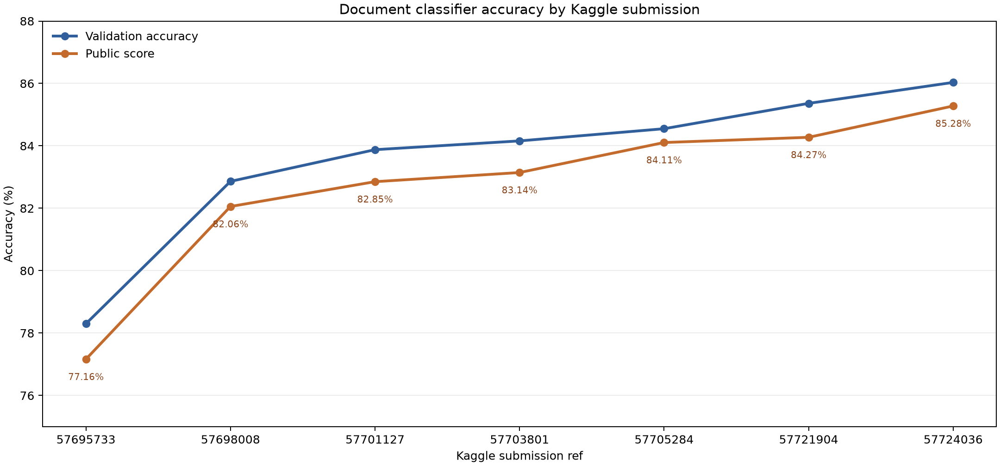

# Supervised Document Image Classification

Proyek klasifikasi gambar dokumen untuk kompetisi `document-image-classification-sd234504`. Tujuannya memprediksi satu dari 16 tipe dokumen berdasarkan tampilan halaman hasil scan. Implementasi model menggunakan PyTorch dan neural network, sesuai ketentuan tugas.

## Dataset

Kompetisi menggunakan subset RVL-CDIP yang terdiri dari 32.003 gambar training dan 7.994 gambar test/evaluasi. File yang diunduh diekstrak ke `data/`:

```text
data/
├── train/train/<class_name>/*.tif
├── test/test/*.tif
├── train.csv
├── test.csv
├── sample_submission.csv
└── document-image-classification-sd234504.zip
```

Dataset dan checkpoint tidak dilacak Git. Folder `data/` dan `checkpoint/` sudah tercantum di `.gitignore`.

### Mengunduh data

Autentikasi Kaggle CLI satu kali pada mesin lokal:

```bash
kaggle auth login
```

Kemudian dari root repository:

```bash
mkdir -p data
kaggle competitions download -c document-image-classification-sd234504 -p data
unzip data/document-image-classification-sd234504.zip -d data
```

Pastikan akun Kaggle memiliki akses ke kompetisi. Jangan menyimpan token atau kredensial di repository.

## Kelas

Label kompetisi adalah integer 0–15 dengan mapping berikut:

| Label | Kategori | Label | Kategori |
| ---: | --- | ---: | --- |
| 0 | advertisement | 8 | memo |
| 1 | budget | 9 | news_article |
| 2 | email | 10 | presentation |
| 3 | file_folder | 11 | questionnaire |
| 4 | form | 12 | resume |
| 5 | handwritten | 13 | scientific_publication |
| 6 | invoice | 14 | scientific_report |
| 7 | letter | 15 | specification |

## Alur eksperimen

1. Inspeksi CSV, struktur folder gambar, distribusi kelas, dan contoh gambar.
2. Bagi data training menjadi train/validation secara stratified dengan seed yang dicatat. Test tidak digunakan untuk tuning.
3. Latih model computer vision berbasis neural network di PyTorch; catat konfigurasi, transformasi, seed, dan checkpoint.
4. Bandingkan eksperimen dengan categorical accuracy pada validation. Accuracy adalah jumlah prediksi yang benar dibagi jumlah sampel.
5. Pilih model berdasarkan hasil validation, lalu prediksi label test.
6. Buat submission dengan kolom persis `id,label`, ID dari `test.csv`, dan label integer 0–15. Validasi jumlah baris 7.994, ID tidak hilang/duplikat, dan label tidak kosong.

Lihat [AGENTS.md](AGENTS.md) untuk alur kerja agent dan [rules.md](rules.md) untuk ketentuan tugas. Update README dengan hasil eksperimen dan interpretasinya setelah training benar-benar dilakukan. Belum ada skor model yang dilaporkan di repository ini.

## Struktur repository

```text
.
├── README.md
├── AGENTS.md
├── rules.md
├── .gitignore
├── requirements.txt
├── pyproject.toml
├── data/                   # CSV, arsip, dan gambar; diabaikan Git
├── notebooks/
│   ├── 01_eda.ipynb
│   ├── 02_modeling.ipynb
│   └── 03_submission.ipynb
├── scripts/
│   ├── train.py
│   └── predict.py
├── src/document_classifier/
│   ├── data.py              # CSV validation and PyTorch Dataset
│   ├── transforms.py        # image resizing and augmentation
│   ├── model.py             # CNN architecture
│   └── submission.py        # submission creation/validation
├── checkpoint/             # bobot hasil training; diabaikan Git
├── submissions/
└── reports/figures/
```

Arsitektur dan komponen data ditempatkan dalam package `src/document_classifier/`, sementara `scripts/` berisi entry point. Artefak bobot PyTorch disimpan di `checkpoint/`. Folder `submissions/` untuk CSV hasil inferensi dan `reports/figures/` untuk visualisasi analisis.

## Menjalankan kode

Siapkan environment dan dependensi:

```bash
python -m venv .venv
source .venv/bin/activate
pip install -r requirements.txt
pip install -e .
```

Notebook berisi langkah awal EDA, validasi split stratified, dan pemeriksaan submission. Training dan prediksi dijalankan dari root repository:

```bash
python scripts/train.py --epochs 3 --batch-size 32 --image-size 224 --workers 2
python scripts/predict.py --batch-size 32 --workers 2
```

Training memilih checkpoint berdasarkan validation accuracy tertinggi dan menyimpan metrik ke `reports/`. Prediksi memakai checkpoint `checkpoint/best.pt` dan menulis `submissions/submission.csv`.

## Hasil baseline

Satu run baseline dilakukan dengan split stratified 80/20 dan seed 42. Model memakai ResNet-18 dengan bobot ImageNet; layer4 dan classifier di-fine-tune selama tiga epoch. Resolusi input 224 × 224, batch size 32, optimizer AdamW dengan learning rate `1e-4`. Run berjalan di CPU.

| Epoch | Train accuracy | Validation accuracy | Validation loss |
| ---: | ---: | ---: | ---: |
| 1 | 65,62% | 74,10% | 0,8611 |
| 2 | 78,16% | 77,74% | 0,7542 |
| 3 | 83,65% | **78,30%** | **0,7308** |

Checkpoint terbaik adalah epoch 3. Validation accuracy naik 4,20 poin persentase dari epoch 1. Selisih train dan validation accuracy pada epoch 3 sekitar 5,35 poin, jadi masih ada ruang untuk memperbaiki generalisasi lewat tuning augmentasi, resolusi, fine-tuning, dan analisis error.

Satu gambar training (`train_08795`) tidak bisa didekode dan dilewati; accuracy train dihitung dari 25.601 gambar yang berhasil dibaca, validation memakai seluruh 6.401 sampel. Detail run ada di `reports/training_history.csv` dan `reports/validation_result.json`, sedangkan ID corrupt dicatat di `reports/corrupt_image_ids.txt`.

Model memprediksi seluruh 7.994 baris test dan menghasilkan `submissions/submission.csv`. File tersebut dikirim ke Kaggle sebagai submission ref `57695733` dengan deskripsi `ResNet18 baseline`. Statusnya `COMPLETE` dan public leaderboard score yang dilaporkan Kaggle adalah **0,77164 (77,164%)**. Ini adalah skor pada bagian test yang dipakai leaderboard publik; private score belum tersedia, jadi belum ada skor untuk keseluruhan test tersembunyi. Validation accuracy lokal adalah **0,78300 (78,300%)** pada split validation. Jangan menyamakan dua skor tersebut: keduanya berasal dari sampel berbeda. Riwayat terstruktur beserta konfigurasi model tersimpan di [`reports/submission_history.csv`](reports/submission_history.csv).

## Submission

Contoh format CSV:

```csv
id,label
test_00001,0
test_00002,12
```

Perintah submit yang digunakan dari root repository:

```bash
kaggle competitions submit -c document-image-classification-sd234504 \
  -f submissions/submission.csv \
  -m "ResNet18 baseline"
```

Batas kompetisi adalah lima submission per hari. Lihat [workflow.md](workflow.md) untuk langkah validasi, pengecekan status, dan pencatatan submission berikutnya.

## Eksperimen lanjutan

Eksperimen v1 dibatalkan sebelum log tersedia; v2 membuktikan Tesla T4 aktif, tetapi gagal menemukan CSV sebelum training. V3 melatih ResNet-18 dengan layer3 dan layer4 terbuka selama 12 epoch pada Tesla T4. Best validation accuracy **82,862%** pada epoch 12, naik 4,56 poin persentase dari baseline validation 78,300%. Train accuracy 99,80%, menandakan overfitting besar. Run lengkap dan log per epoch tersimpan di `reports/experiments/resnet18_layer3_v3/`.

Submission v3 (`57698008`) mendapat public score **0,82057 (82,057%)**, naik **4,893 poin persentase** dari baseline Kaggle 77,164% dan melampaui target 79,164%. Private score belum tersedia. Submission CSV dan hash manifest tersimpan di `submissions/`; riwayat seluruh submission ada di `reports/submission_history.csv`.

Untuk loop ini, kandidat berikutnya dikirim jika validation accuracy **di atas 80%** dan mengalahkan model terbaik sebelumnya. Skrip `scripts/submit_candidate.py` memeriksa validasi, checkpoint, format/urutan CSV, dan riwayat Kaggle sebelum mengirim; skrip berhenti bila hitungan submission mencapai lima. Kuota diperiksa berdasarkan hitungan hari UTC dan jumlah yang tersedia dari `kaggle competitions submission-limits`. Petunjuk lengkap ada di [workflow.md](workflow.md).

Run v4 membandingkan ResNet-50 dengan padding putih untuk mempertahankan proporsi halaman, learning rate `5e-5`, dan empat epoch maksimum di Tesla T4. Best validation accuracy **80,019%** pada epoch 4. Prediksi untuk semua 7.994 baris test berhasil dibuat dan divalidasi. Run ini tidak disubmit karena hasilnya di bawah model terbaik sebelumnya (82,862% validation; public score 82,057%). Log per epoch dan hasil lengkap tersimpan di `reports/experiments/resnet50_aspect_v1/`; ringkasan konfigurasi ada di `reports/experiments/resnet50_aspect_v1.json`.

Run v5 melanjutkan ResNet-50 dengan preprocessing dan optimizer sama, hingga 12 epoch. Best validation accuracy **82,237%** pada epoch 12, sementara train accuracy mencapai 99,04%, menunjukkan overfitting. Prediksi seluruh 7.994 ID tervalidasi. Run ini tidak disubmit karena masih di bawah ResNet-18 terbaik (82,862% validation; 82,057% public). Log dan laporan lengkap ada di `reports/experiments/resnet50_aspect_v2/` dan ringkasan run di `reports/experiments/resnet50_aspect_v2.json`.

Run v6 menggunakan ResNet-18, padding untuk mempertahankan rasio halaman, dan augmentasi affine/brightness/contrast ringan. Best validation accuracy **83,878%** pada epoch 12, melampaui model terbaik sebelumnya sebesar **1,016 poin persentase**. Submission ref `57701127` mendapat public score **0,82852 (82,852%)**, naik **5,688 poin persentase** dari baseline Kaggle dan **0,795 poin persentase** dari submission terbaik sebelumnya. Private score belum tersedia. Riwayat run dan metrik ada di `reports/experiments/resnet18_aug_v1/`, CSV submission beserta hash manifest ada di `submissions/`, dan semua submission tercatat di `reports/submission_history.csv`.

Run v7 fine-tuned ResNet-18 from `layer2`, with 224px aspect-preserving input, mild affine/color augmentation, learning rate `5e-5`, and no label smoothing. It reached **84,159% validation accuracy** at epoch 12, a 0,281-point improvement over v6. Kaggle submission ref `57703801` completed with public score **0,83145 (83,145%)**, improving the previous public best by 0,293 points and the baseline by 6,286 points. One corrupt training image (`train_08795`) was skipped. Full metrics are in `reports/experiments/resnet18_layer2_v1/`; its submission and hash manifest are in `submissions/`. Validation remains below the 85% stretch target, so the loop continues while observing the five-submission daily limit.

Run v8 kept ResNet-18 fine-tuning from `layer2` and increased aspect-preserving input to 256px. It reached **84,550% validation accuracy** at epoch 12, improving v7 by 0,391 points. Kaggle submission ref `57705284` completed with public score **0,84107 (84,107%)**, up 0,961 points from v7 and 6,943 points from baseline 77,164%. This is the best result so far. Submission 5/5 for 2026-10-27 UTC is reached, so no further submissions are made today. Full experiment output is in `reports/experiments/resnet18_layer2_256_v1/`; its CSV and hash manifest are in `submissions/`.

Tren hasil validation dan public leaderboard per submission:



Pada 28 Oktober, ensemble probabilitas dua checkpoint ResNet-18 berukuran 224px dan 256px (bobot 0,3 dan 0,7) mencapai **84,955% validation accuracy** pada split yang sama. Prediksi 7.994 ID dan hash checkpoint telah diperiksa; kandidat menunggu kuota dan belum memiliki public score. Konfigurasi dan metrik ada di `reports/experiments/ensemble_224_256_v1.json`. Evaluasi dapat diulang dengan `scripts/evaluate_ensemble.py`; checkpoint berasal dari output kernel masing-masing dan tetap diabaikan Git.

Ensemble dengan bobot sama untuk checkpoint 224px dan 256px mencapai **85,362% validation accuracy** dan dikirim sebagai submission `57721904` pada 28 Oktober. Public score-nya **0,84274 (84,274%)**, naik 0,167 poin persentase dari public best sebelumnya. Riwayat konfigurasi dan hash ada di `reports/experiments/ensemble_224_256_equal_v1.json` dan `reports/submission_history.csv`.

ResNet-18 320px pada 28 Oktober mencapai **84,846% validation accuracy** (epoch 11). Checkpoint dan 7.994 prediksi tervalidasi; model tunggal tidak disubmit karena masih di bawah ensemble terbaik 85,362%. Hasil lengkap ada di `reports/experiments/resnet18_layer2_320_v1/` dan checkpoint dipertimbangkan untuk ensemble berikutnya.

Ensemble tiga checkpoint ResNet-18 berukuran 224px, 256px, dan 320px dengan bobot sama mencapai **86,033% validation accuracy** pada split seed 42. Submission `57724036` mendapat public score **0,85278 (85,278%)**, naik 1,004 poin persentase dari submission dua model. Inferensi CPU sempat terputus dan dilanjutkan menggunakan cache per checkpoint; detail, hash, dan riwayatnya ada di `reports/experiments/ensemble_224_256_320_v1.json` dan `reports/submission_history.csv`.
